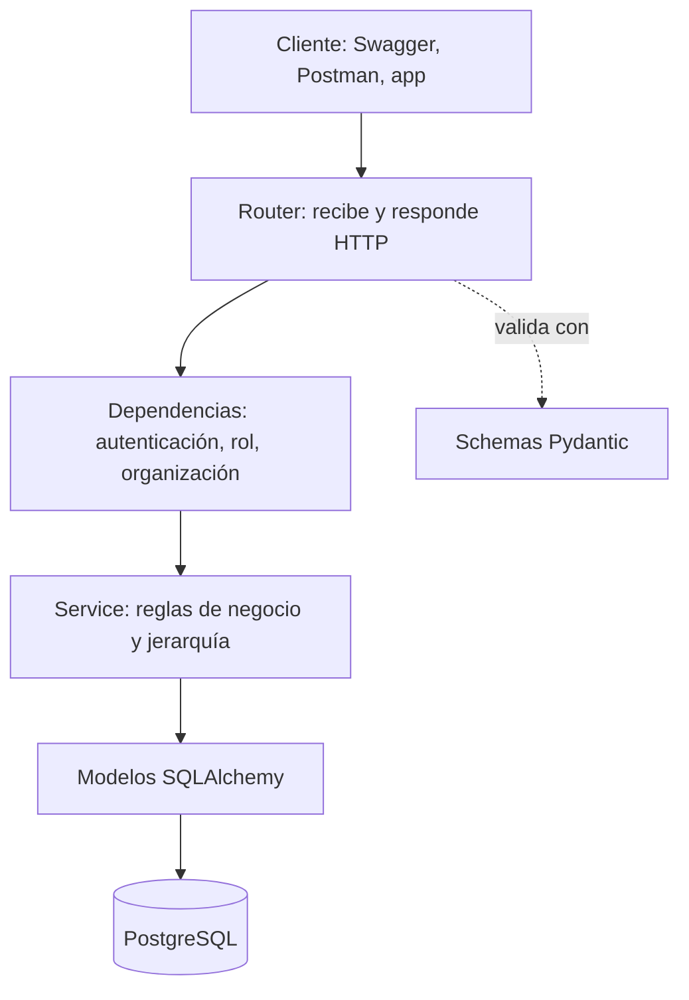
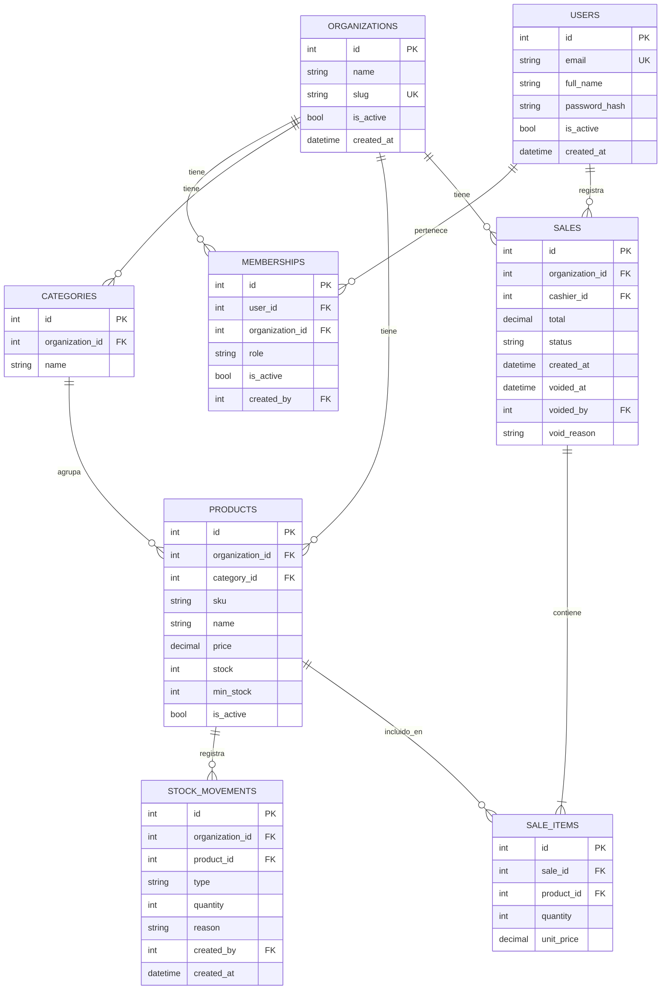

# StockNest: plan del proyecto

Plataforma multi-negocio (multi-tenant) de **inventario y ventas** para pequeños comercios (colmados, tiendas, talleres). Varios negocios usan el mismo sistema y cada uno ve únicamente sus propios datos.

> Este documento es la referencia de estructura, módulos y requerimientos. Los casos de uso, historias de usuario y diagramas de flujo están en `02_CASOS_DE_USO_Y_HISTORIAS.md`.

Estado: **diseño (borrador 2: roles owner, manager y cashier confirmados)** · Fecha: 2026-10-22

---

## 1. Resumen

| Aspecto | Descripción |
|---|---|
| Problema | Los negocios pequeños llevan el inventario y las ventas en cuadernos o en hojas de cálculo: se pierde stock, se vende lo que no hay y no saben cuánto ganan |
| Solución | API backend donde cada negocio registra productos, controla su stock y registra ventas, con usuarios y permisos por rol |
| Diferencial técnico | Multi-tenant: aislamiento estricto de datos entre negocios, roles jerárquicos por negocio, pruebas que demuestran el aislamiento y la jerarquía |
| Usuarios | Owner (dueño), manager (encargado del negocio) y cashiers (cajeros) |
| Alcance | Backend (API REST). Sin frontend elaborado; se usa `/docs` de FastAPI |

### Objetivos de aprendizaje
- Relaciones entre tablas y transacciones con SQLAlchemy 2.x.
- Autenticación: hash de contraseñas, JWT, OAuth2 en FastAPI.
- Autorización por roles jerárquicos y por organización.
- Migraciones con Alembic.
- Pruebas automáticas con pytest.
- Entorno con Docker Compose y despliegue en la nube.
- Control de versiones con Git y GitHub.

### Fuera del alcance (a propósito)
Frontend elaborado, pagos reales, facturación fiscal, múltiples sucursales por negocio, aplicaciones móviles, colas de mensajes, microservicios, caché, varios owners por negocio.

---

## 2. Stack tecnológico

| Capa | Tecnología | Estado |
|---|---|---|
| Lenguaje | Python 3.13 | Ya conocida |
| API | FastAPI + Uvicorn | Ya conocida |
| Validación | Pydantic v2 | Ya conocida |
| ORM | SQLAlchemy 2.x | Ya conocida (se profundiza en relaciones) |
| Base de datos | PostgreSQL 18 (imagen `postgres:18`) | Ya conocida |
| Contenedores | Docker + Docker Compose | Compose es nuevo |
| Configuración | `pydantic-settings` + `.env` | Nuevo |
| Hash de contraseñas | `argon2` (paquete `argon2-cffi`) | Nuevo |
| Tokens | JWT (`PyJWT`) + OAuth2PasswordBearer | Nuevo |
| Migraciones | Alembic | Nuevo |
| Pruebas | pytest + `TestClient` de FastAPI | Nuevo |
| Control de versiones | Git + GitHub | Nuevo |
| CI (opcional) | GitHub Actions | Nuevo, si hay tiempo |
| Despliegue | Servicio en la nube (por decidir) | Nuevo |

---

## 3. Arquitectura

### 3.1 Capas



| Capa | Responsabilidad | Regla |
|---|---|---|
| Router | Define rutas, códigos de estado y esquemas | No contiene lógica de negocio |
| Dependencias | Identifica al usuario, su organización y su rol; exige un rol mínimo | Aquí nace el contexto de seguridad |
| Service | Reglas de negocio (stock, ventas) y validación de jerarquía sobre usuarios | Recibe siempre la organización |
| Modelos | Tablas y relaciones | Toda tabla de negocio lleva `organization_id` |
| Schemas | Entrada y salida de la API | Nunca se expone el hash de la contraseña |

### 3.2 Estrategia multi-tenant

Se usa **base de datos única y esquema compartido**: todas las tablas de negocio llevan la columna `organization_id`.

| Decisión | Motivo |
|---|---|
| Esquema compartido con `organization_id` | Es el más sencillo y el más usado; basta para el MVP |
| El `organization_id` sale del **token JWT**, nunca del cuerpo ni de la URL | Evita que un usuario consulte otra organización cambiando un parámetro |
| Toda consulta de servicio filtra por `organization_id` | Una consulta sin filtro es una fuga de datos |
| Restricciones únicas compuestas, por ejemplo `(organization_id, sku)` | Dos negocios pueden tener el mismo SKU |
| Pruebas dedicadas de aislamiento | Demuestran que la organización A no ve ni modifica datos de la B |

Contenido del token:

```json
{
  "sub": "id del usuario",
  "org": "id de la organización",
  "role": "owner | manager | cashier",
  "exp": "expiración"
}
```

### 3.3 Jerarquía de roles

Cada rol tiene un nivel numérico:

| Rol | Nivel | Puede gestionar usuarios de rol |
|---|---|---|
| `owner` | 3 | `manager` y `cashier` |
| `manager` | 2 | `cashier` |
| `cashier` | 1 | Ninguno |

**Regla de jerarquía:** un usuario solo puede crear, desactivar o reactivar a usuarios cuyo nivel sea **estrictamente menor** que el suyo.

Hay dos controles distintos, y los dos son obligatorios:

| Control | Pregunta que responde | Dónde vive | Error |
|---|---|---|---|
| Rol mínimo | ¿Este rol puede usar esta ruta? | Dependencia `require_role(...)` en el router | 403 |
| Jerarquía | ¿Este rol puede actuar sobre **este** usuario? | Servicio de usuarios, comparando niveles | 403 |

**La interfaz no es una medida de seguridad.** Una interfaz puede ocultar las opciones que un rol no debe ver, pero esta API puede llamarse directamente (Swagger, Postman, scripts). Por eso el backend valida siempre, y la prueba `test_hierarchy.py` lo demuestra llamando a la API como un manager que intenta tocar a otro manager.

---

## 4. Estructura de carpetas

```
StockNest/
├── app/
│   ├── main.py                    Punto de entrada (FastAPI)
│   ├── core/
│   │   ├── config.py              Variables de entorno (pydantic-settings)
│   │   ├── security.py            Hash de contraseñas y creación/lectura de JWT
│   │   ├── roles.py               Roles, niveles y funciones de jerarquía
│   │   └── exceptions.py          Errores de negocio propios
│   ├── db/
│   │   ├── base.py                Base declarativa y registro de modelos
│   │   └── session.py             Engine, SessionLocal y get_db
│   └── modules/
│       ├── auth/                  Registro, login, usuario actual
│       │   ├── router.py
│       │   ├── schemas.py
│       │   ├── service.py
│       │   └── dependencies.py    get_current_user, require_role
│       ├── organizations/         Negocios (tenants)
│       ├── users/                 Usuarios, membresías, roles y jerarquía
│       ├── products/              Catálogo de productos y categorías
│       ├── inventory/             Movimientos y ajustes de stock
│       ├── sales/                 Ventas, líneas de venta, anulaciones
│       └── reports/               Resúmenes y reportes básicos
│           (cada módulo: models.py, schemas.py, service.py, router.py)
├── alembic/                       Migraciones
├── alembic.ini
├── tests/
│   ├── conftest.py                Base de pruebas y fixtures
│   ├── test_auth.py
│   ├── test_isolation.py          Aislamiento entre organizaciones
│   ├── test_hierarchy.py          Jerarquía owner > manager > cashier
│   ├── test_products.py
│   ├── test_inventory.py
│   └── test_sales.py
├── docs/
│   ├── 01_PLAN_DEL_PROYECTO.md
│   └── 02_CASOS_DE_USO_Y_HISTORIAS.md
├── docker-compose.yml             API + PostgreSQL
├── Dockerfile
├── requirements.txt
├── .env                           Secretos (ignorado por git)
├── .env.example                   Plantilla sin secretos (sí se sube)
├── .gitignore
└── README.md
```

Convención de cada módulo:

| Archivo | Contenido |
|---|---|
| `models.py` | Clases SQLAlchemy |
| `schemas.py` | Esquemas Pydantic de entrada y salida |
| `service.py` | Funciones con la lógica de negocio |
| `router.py` | Endpoints; solo llaman al servicio |

---

## 5. Módulos

| # | Módulo | Responsabilidad | Depende de |
|---|---|---|---|
| 1 | **core / db** | Configuración, conexión, sesión, seguridad, roles | - |
| 2 | **auth** | Registro de negocio, login, emisión y validación de JWT | users, organizations |
| 3 | **organizations** | Datos del negocio (tenant) | - |
| 4 | **users** | Usuarios, membresías, roles y reglas de jerarquía | organizations |
| 5 | **products** | Productos y categorías, activar y desactivar | organizations |
| 6 | **inventory** | Entradas, salidas y ajustes de stock con historial | products |
| 7 | **sales** | Registrar ventas, descontar stock, anular ventas | products, inventory |
| 8 | **reports** | Ventas por periodo, productos más vendidos, stock bajo | sales, products |

---

## 6. Modelo de datos



### Reglas del modelo

| Tabla | Restricciones |
|---|---|
| `users` | `email` único en todo el sistema |
| `memberships` | Único `(user_id, organization_id)`; `role` es `owner`, `manager` o `cashier`; **un solo `owner` activo por organización** (índice único parcial sobre `organization_id` donde `role = 'owner'`) |
| `categories` | Único `(organization_id, name)` |
| `products` | Único `(organization_id, sku)`; `price >= 0`; `stock >= 0`; nunca se borran, se desactivan (`is_active`) |
| `stock_movements` | `type`: `entry`, `exit`, `adjustment`, `sale`, `void`; es un historial que no se edita; `reason` obligatorio en ajustes |
| `sales` | `status`: `completed` o `voided`; `total` se calcula en el servidor; `void_reason` obligatorio al anular |
| `sale_items` | Guarda `unit_price` al momento de la venta (copia del precio, no referencia) |

---

## 7. Roles y permisos (confirmado)

Jerarquía: **owner > manager > cashier**. El owner puede todo lo que puede el manager, y el manager puede todo lo que puede el cashier, más lo propio de su nivel.

| Acción | Owner | Manager | Cashier |
|---|---|---|---|
| **Negocio** | | | |
| Registrar un negocio nuevo | Público (crea al owner) | - | - |
| Ver datos del negocio | Sí | Sí | Sí |
| Editar datos del negocio | Sí | No | No |
| Transferir la propiedad o desactivar el negocio | Sí | No | No |
| **Usuarios** | | | |
| Crear, desactivar y reactivar managers | Sí | No | No |
| Crear, desactivar y reactivar cashiers | Sí | Sí | No |
| Cambiar el rol de un usuario | Sí (a manager o cashier) | No | No |
| Listar usuarios | Todos | Cashiers y a sí mismo | No |
| **Productos** | | | |
| Ver productos y stock | Sí | Sí | Sí |
| Crear y editar productos | Sí | Sí | No |
| Cambiar precios | Sí | Sí | No |
| Desactivar productos | Sí | Sí | No |
| Gestionar categorías | Sí | Sí | No |
| **Inventario** | | | |
| Registrar entradas de stock | Sí | Sí | No |
| Registrar ajustes (con motivo) | Sí | Sí | No |
| Ver historial de movimientos | Sí | Sí | No |
| Ver productos con stock bajo | Sí | Sí | Sí |
| **Ventas** | | | |
| Registrar una venta | Sí | Sí | Sí |
| Ver ventas | Todas | Todas | Solo las propias |
| Anular una venta (con motivo) | Sí | Sí | No |
| **Reportes** | | | |
| Resumen de ventas y más vendidos | Sí | Sí | No |

### Decisiones tomadas sobre los roles

| # | Decisión | Resultado |
|---|---|---|
| 1 | El manager puede anular ventas | Sí, con motivo obligatorio y quedando registrado quién y cuándo |
| 2 | El manager puede cambiar precios | Sí |
| 3 | El cashier puede ver el stock | Sí |
| 4 | Varios owners por negocio | No; uno por negocio en el MVP |
| 5 | Un manager sobre otro manager | No puede tocarlo: validado en el backend, además de ocultarse en la interfaz |

---

## 8. Requerimientos funcionales

| ID | Requerimiento | Módulo | Prioridad |
|---|---|---|---|
| RF-01 | Un visitante puede registrar un negocio nuevo, lo que crea la organización y su owner | auth, organizations | Alta |
| RF-02 | Un usuario puede iniciar sesión con correo y contraseña y recibir un JWT | auth | Alta |
| RF-03 | El sistema identifica usuario, organización y rol a partir del token | auth | Alta |
| RF-04 | El owner puede crear managers y cashiers dentro de su negocio | users | Alta |
| RF-05 | El owner puede desactivar y reactivar managers y cashiers | users | Media |
| RF-06 | Owner y manager pueden crear, editar, listar y desactivar productos | products | Alta |
| RF-07 | Owner y manager pueden organizar productos por categorías | products | Media |
| RF-08 | Los productos tienen SKU único dentro del negocio | products | Alta |
| RF-09 | Owner y manager pueden registrar entradas de stock y ajustes | inventory | Alta |
| RF-10 | Cada cambio de stock queda en un historial consultable | inventory | Alta |
| RF-11 | El sistema muestra los productos con stock por debajo del mínimo | inventory, reports | Media |
| RF-12 | Cualquier rol puede registrar una venta con varias líneas de producto | sales | Alta |
| RF-13 | Al registrar una venta se descuenta el stock en la misma transacción | sales | Alta |
| RF-14 | No se permite vender más cantidad que el stock disponible | sales | Alta |
| RF-15 | El total de la venta se calcula en el servidor con los precios actuales | sales | Alta |
| RF-16 | Owner y manager pueden anular una venta, con motivo, lo que devuelve el stock | sales | Media |
| RF-17 | El cashier solo ve sus propias ventas; owner y manager ven todas | sales | Alta |
| RF-18 | Owner y manager pueden ver ventas por rango de fechas y totales | reports | Media |
| RF-19 | Owner y manager pueden ver los productos más vendidos | reports | Baja |
| RF-20 | Todas las listas admiten paginación | todos | Media |
| RF-21 | El manager puede crear, desactivar y reactivar cashiers | users | Alta |
| RF-22 | Ningún usuario puede gestionar a otro de su mismo nivel o superior | users | Alta |
| RF-23 | Solo el owner puede cambiar el rol de un usuario y editar los datos del negocio | users, organizations | Media |
| RF-24 | Transferir la propiedad del negocio a otro usuario | users | Baja (post-MVP) |
| RF-25 | Registrar el historial de cambios de precio | products | Baja (post-MVP) |

## 9. Requerimientos no funcionales

| ID | Requerimiento | Cómo se verifica |
|---|---|---|
| RNF-01 | **Aislamiento de datos**: ningún usuario accede a datos de otra organización | `tests/test_isolation.py` |
| RNF-02 | Las contraseñas se guardan con hash, nunca en texto plano | Revisión del código y prueba |
| RNF-03 | Los secretos viven en variables de entorno, no en el código | `.env` en `.gitignore` y `.env.example` |
| RNF-04 | Las ventas son transaccionales: o se guarda todo o nada | Prueba de venta con stock insuficiente |
| RNF-05 | Errores claros con códigos HTTP correctos (401, 403, 404, 409, 422) | Pruebas de endpoints |
| RNF-06 | Cambios de esquema versionados con Alembic | Carpeta `alembic/versions` |
| RNF-07 | Todo el entorno se levanta con `docker compose up` | `docker-compose.yml` |
| RNF-08 | Cobertura de pruebas en las rutas críticas (auth, aislamiento, jerarquía, ventas) | pytest |
| RNF-09 | Documentación de la API en `/docs` y `README` completo | Revisión manual |
| RNF-10 | El proyecto está desplegado y accesible en línea | URL pública |
| RNF-11 | **Los permisos y la jerarquía se validan en el backend**, sin depender de lo que muestre la interfaz | `tests/test_hierarchy.py` |

---

## 10. Resumen de endpoints (previsto)

Prefijo: `/api/v1`

| Módulo | Método | Ruta | Roles |
|---|---|---|---|
| auth | POST | `/auth/register` | Público |
| auth | POST | `/auth/login` | Público |
| auth | GET | `/auth/me` | Autenticado |
| organizations | GET | `/organization` | Autenticado |
| organizations | PUT | `/organization` | Owner |
| users | GET | `/users` | Owner, manager (filtrado por jerarquía) |
| users | POST | `/users` | Owner (manager o cashier), manager (solo cashier) |
| users | PATCH | `/users/{id}/status` | Owner, manager (solo sobre rol inferior) |
| users | PATCH | `/users/{id}/role` | Owner |
| products | GET | `/products` | Autenticado |
| products | POST | `/products` | Owner, manager |
| products | GET | `/products/{id}` | Autenticado |
| products | PUT | `/products/{id}` | Owner, manager |
| products | PATCH | `/products/{id}/status` | Owner, manager |
| products | GET | `/categories` | Autenticado |
| products | POST | `/categories` | Owner, manager |
| inventory | POST | `/inventory/movements` | Owner, manager |
| inventory | GET | `/inventory/movements` | Owner, manager |
| inventory | GET | `/inventory/low-stock` | Autenticado |
| sales | POST | `/sales` | Autenticado |
| sales | GET | `/sales` | Autenticado (el cashier ve solo las suyas) |
| sales | GET | `/sales/{id}` | Autenticado (el cashier solo las suyas) |
| sales | POST | `/sales/{id}/void` | Owner, manager |
| reports | GET | `/reports/sales-summary` | Owner, manager |
| reports | GET | `/reports/top-products` | Owner, manager |

Nota: el `organization_id` no aparece en ninguna ruta; siempre se toma del token.

---

## 11. Reglas de negocio

1. Una venta tiene al menos una línea, y cada línea tiene cantidad mayor que cero.
2. El precio de cada línea es el precio vigente del producto, copiado a `sale_items.unit_price`.
3. Una venta solo se confirma si **todas** sus líneas tienen stock suficiente.
4. Registrar una venta descuenta el stock y crea un movimiento `sale` por línea, en una sola transacción.
5. Anular una venta exige un motivo, devuelve el stock con movimientos `void` y marca la venta como `voided`. Una venta anulada no se vuelve a anular.
6. Los productos no se eliminan; se desactivan. Un producto desactivado no se puede vender, pero sigue apareciendo en ventas históricas.
7. Un correo solo puede registrarse una vez en el sistema.
8. Un usuario desactivado no puede iniciar sesión.
9. **Jerarquía:** un usuario solo gestiona a quienes tienen un nivel estrictamente inferior (owner > manager > cashier).
10. Cada negocio tiene exactamente un owner. El owner no puede desactivarse a sí mismo.
11. Solo el owner crea managers y cambia roles.
12. Los ajustes de stock exigen un motivo.
13. Un manager solo lista y ve a los cashiers y a sí mismo.

---

## 12. Plan de entrega

| Fechas | Objetivo | Entregable |
|---|---|---|
| 20 oct - 27 oct | Git y GitHub (catálogo) y diseño de este proyecto | Repositorio del catálogo y documentos de diseño |
| 27 oct - 3 nov | Estructura, configuración, modelos y relaciones, primera migración | Tablas creadas con Alembic |
| 3 nov - 10 nov | Registro de negocio, login, hash, JWT | Autenticación funcionando |
| 10 nov - 17 nov | Roles, jerarquía, aislamiento, módulo de usuarios | Rutas protegidas por rol y pruebas de jerarquía |
| 17 nov - 24 nov | Productos, categorías e inventario | Stock con historial |
| 24 nov - 1 dic | Ventas transaccionales y anulaciones | Flujo de venta completo |
| 1 dic - 8 dic | Reportes, pruebas, `docker-compose` | Pruebas de aislamiento y ventas |
| 8 dic - 15 dic | Despliegue, `README`, CV | Proyecto en línea |
| 15 dic - 31 dic | Colchón | Retrasos y repaso |

Si hay retraso, se recorta en este orden: reportes, despliegue pulido, GitHub Actions. No se recortan el aislamiento, la jerarquía ni sus pruebas.

---

## 13. Decisiones pendientes

| # | Decisión | Opciones | Recomendación |
|---|---|---|---|
| 1 | Cómo se crea un negocio | Registro público, o creado por un administrador de plataforma | Registro público (más simple) |
| 2 | Un usuario en varios negocios | Soportarlo (membresías) o limitar a uno | Modelar con membresías, usar uno en el MVP |
| 3 | Login con varias membresías | Pedir el `slug` del negocio al iniciar sesión | Pedir `slug` solo si hay más de una |
| 4 | Dónde desplegar | Por investigar | Decidir en noviembre |
### Decisiones resueltas

| Decisión | Resultado | Consecuencia |
|---|---|---|
| Matriz de roles (sección 7) y las cinco decisiones de roles | Confirmadas | Tres roles jerárquicos |
| Tipo de ID | **Entero autoincremental** | Los IDs son predecibles, así que el aislamiento depende de filtrar siempre por `organization_id` y de responder 404 (nunca 403) ante un recurso de otra organización |
| Hash de contraseñas | **argon2** | Librería `argon2-cffi`; se guarda el hash completo, que ya incluye sal y parámetros |
| Respuesta ante violación de jerarquía | **403** | Un manager que intenta tocar a otro manager o al owner recibe 403: el usuario existe y es visible dentro de su negocio. El 404 queda reservado para recursos de **otra** organización |

---

## 14. Definición de terminado

Un módulo se considera terminado cuando:
- Sus endpoints responden con los códigos correctos y aparecen en `/docs`.
- Todas sus consultas filtran por `organization_id`.
- Valida el rol mínimo y, si actúa sobre usuarios, la jerarquía.
- Tiene pruebas, incluida una de aislamiento.
- Sus cambios de esquema están en una migración de Alembic.
- Está subido a GitHub con commits claros.
