# StockNest: casos de uso, historias de usuario y flujos

Complemento de `01_PLAN_DEL_PROYECTO.md`. Para cada módulo se incluye:
1. Actores y casos de uso
2. Historias de usuario con criterios de aceptación
3. Diagrama de flujo

Los diagramas usan Mermaid (se ven en VSCode con una extensión de vista previa de Mermaid, y en GitHub).

**Actores**

| Actor | Rol | Nivel | Descripción |
|---|---|---|---|
| Visitante | - | - | Persona sin sesión iniciada |
| Owner | `owner` | 3 | Dueño del negocio; puede hacer todo |
| Manager | `manager` | 2 | Encargado del negocio; lleva la operación y a los cajeros |
| Cashier | `cashier` | 1 | Registra ventas y consulta productos |
| Sistema | - | - | Acciones automáticas (validaciones, cálculos, historial) |

**Convención de ID:** `CU-xx` caso de uso, `HU-xx` historia de usuario, `RF-xx` requerimiento funcional del documento 01.

**Regla de jerarquía** (se aplica en todo el documento): un usuario solo puede gestionar a quienes tienen un nivel estrictamente inferior. La interfaz puede ocultar opciones, pero el backend siempre valida.

---

## Módulo 1: Autenticación (`auth`)

### Casos de uso

| ID | Caso de uso | Actor | RF |
|---|---|---|---|
| CU-01 | Registrar un negocio nuevo | Visitante | RF-01 |
| CU-02 | Iniciar sesión | Visitante, Owner, Manager, Cashier | RF-02 |
| CU-03 | Consultar mi perfil | Owner, Manager, Cashier | RF-03 |
| CU-04 | Rechazar acceso sin permisos | Sistema | RF-03 |

**CU-01 · Registrar un negocio nuevo**
- Precondición: el correo no existe en el sistema.
- Flujo principal: el visitante envía nombre del negocio, su nombre, correo y contraseña → el sistema valida los datos → crea la organización → crea el usuario con contraseña hasheada → crea la membresía con rol `owner` → responde con los datos creados.
- Flujos alternos: correo ya registrado (409); datos inválidos (422); contraseña débil (422).
- Postcondición: existe una organización con un owner.

**CU-02 · Iniciar sesión**
- Precondición: el usuario existe y está activo.
- Flujo principal: envía correo y contraseña → el sistema verifica el hash → busca la membresía activa → genera el JWT con usuario, organización y rol → devuelve el token.
- Flujos alternos: credenciales incorrectas (401); usuario desactivado (403); sin membresía activa (403).

### Historias de usuario

**HU-01** Como dueño de un negocio, quiero registrarme y crear mi negocio, para empezar a usar el sistema sin depender de nadie.
- Se crean la organización, el usuario y la membresía de owner en una sola operación.
- Si falla un paso, no se crea nada.
- La respuesta nunca incluye la contraseña ni su hash.

**HU-02** Como usuario, quiero iniciar sesión con mi correo y contraseña, para acceder solo a la información de mi negocio.
- Con credenciales correctas recibo un token con vencimiento.
- Con credenciales incorrectas recibo 401 sin indicar si falló el correo o la contraseña.

**HU-03** Como usuario autenticado, quiero ver mi perfil y mi rol, para saber con qué permisos estoy trabajando.

### Diagrama de flujo: registro e inicio de sesión

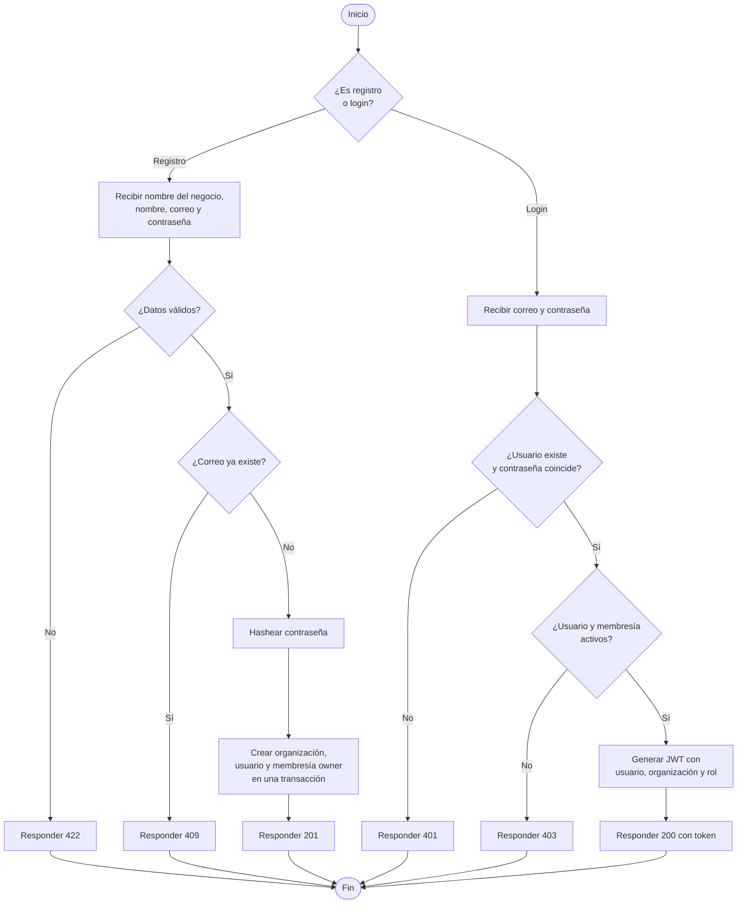

### Diagrama de flujo: validación de cada petición protegida

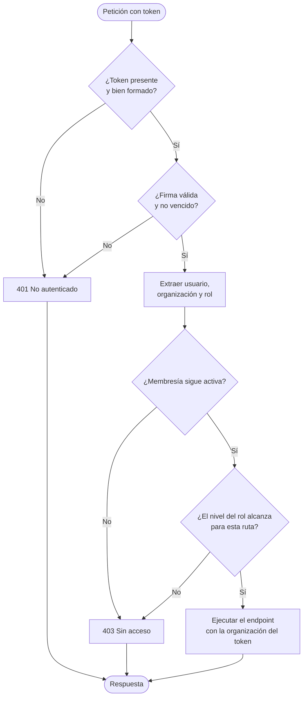

---

## Módulo 2: Organizaciones (`organizations`)

### Casos de uso

| ID | Caso de uso | Actor | RF |
|---|---|---|---|
| CU-05 | Ver datos del negocio | Owner, Manager, Cashier | RF-03 |
| CU-06 | Editar datos del negocio | Owner | RF-23 |
| CU-07 | Transferir la propiedad o desactivar el negocio | Owner | RF-24 (post-MVP) |

**CU-06 · Editar datos del negocio**
- Precondición: sesión iniciada como owner.
- Flujo principal: envía los campos a cambiar → el sistema valida → actualiza la organización del token → responde con los datos.
- Alternos: rol manager o cashier (403); datos inválidos (422).

### Historias de usuario

**HU-04** Como owner, quiero editar el nombre de mi negocio, para mantener mis datos al día.
- Solo puedo editar la organización a la que pertenezco.
- No existe ninguna ruta que reciba el ID de otra organización.

**HU-05** Como manager o cashier, quiero ver el nombre de mi negocio, para confirmar en qué organización estoy trabajando.

**HU-06** Como owner, quiero que solo yo pueda cambiar los datos del negocio, para que un manager no modifique la identidad del negocio.
- Un manager que intenta editar el negocio recibe 403.

### Diagrama de flujo

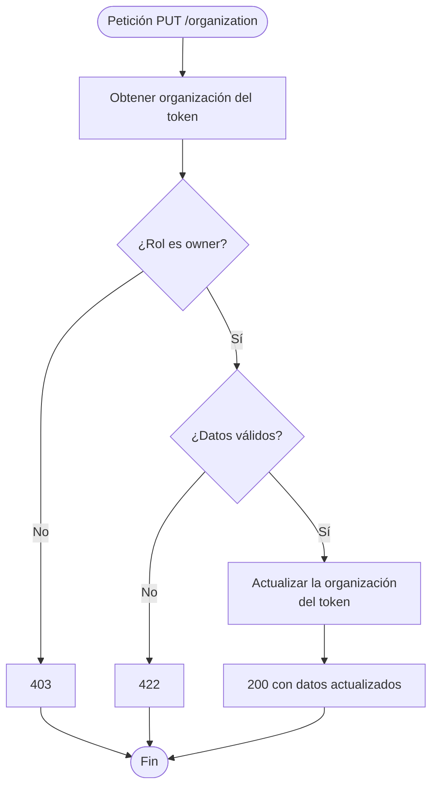

---

## Módulo 3: Usuarios, roles y jerarquía (`users`)

### Casos de uso

| ID | Caso de uso | Actor | RF |
|---|---|---|---|
| CU-08 | Crear un manager | Owner | RF-04 |
| CU-09 | Crear un cashier | Owner, Manager | RF-04, RF-21 |
| CU-10 | Listar usuarios | Owner, Manager | RF-04 |
| CU-11 | Desactivar o reactivar un usuario | Owner, Manager | RF-05, RF-21 |
| CU-12 | Cambiar el rol de un usuario | Owner | RF-23 |
| CU-13 | Rechazar una acción sobre un usuario de nivel igual o superior | Sistema | RF-22 |

**CU-09 · Crear un cashier**
- Precondición: sesión como owner o manager.
- Flujo principal: envía nombre, correo y contraseña inicial → el sistema valida → si el correo no existe, crea el usuario; si existe, solo crea la membresía → asigna rol `cashier` en la organización del token.
- Alternos: el correo ya pertenece a este negocio (409); datos inválidos (422).

**CU-08 · Crear un manager**
- Precondición: sesión como owner.
- Flujo principal: igual que CU-09, pero con rol `manager`.
- Alternos: si quien lo intenta es un manager, 403 (el nivel del nuevo rol no es inferior al suyo).

**CU-11 · Desactivar un usuario**
- Flujo principal: el actor elige un usuario de su negocio → el sistema compara niveles → si el nivel del actor es mayor, desactiva la membresía → el usuario ya no puede iniciar sesión en ese negocio.
- Alternos: nivel igual o superior (403); usuario inexistente o de otro negocio (404); el usuario es el owner (403).

**CU-12 · Cambiar el rol**
- Precondición: sesión como owner.
- Flujo principal: elige el usuario y el nuevo rol (`manager` o `cashier`) → el sistema actualiza la membresía.
- Alternos: intentar asignar `owner` (409, solo hay un owner por negocio); actor que no es owner (403).

**CU-10 · Listar usuarios**
- El owner ve todos los usuarios del negocio. El manager ve solo a los cashiers y a sí mismo.

### Historias de usuario

**HU-07** Como owner, quiero crear managers y cashiers, para delegar la operación del negocio.
- Puedo asignar el rol `manager` o `cashier`.
- Los usuarios creados solo tienen acceso a mi negocio.

**HU-08** Como manager, quiero crear cuentas para mis cajeros, para que cada uno use su propio acceso y quede registro de quién vendió.
- Solo puedo crear usuarios con rol `cashier`.
- Si intento crear un manager, recibo 403.

**HU-09** Como owner o manager, quiero desactivar a un usuario de nivel inferior que ya no trabaja conmigo, para que no pueda seguir entrando.
- Sus ventas anteriores se conservan.
- No puedo desactivar a alguien de mi mismo nivel o superior.

**HU-10** Como manager, quiero que el sistema no me permita modificar a otro manager ni al owner, para evitar conflictos de autoridad.
- Al intentarlo vía API, recibo 403.
- Una interfaz puede además ocultar esas opciones, pero la restricción no depende de ella.

**HU-11** Como owner, quiero ver todos los usuarios de mi negocio con su rol y estado, para controlar quién tiene acceso.

**HU-12** Como owner, quiero poder cambiar el rol de un usuario, para ascender a un cashier o ajustar responsabilidades.
- Solo puedo asignar `manager` o `cashier`.
- Un manager no puede cambiar roles.

### Diagrama de flujo: crear un usuario

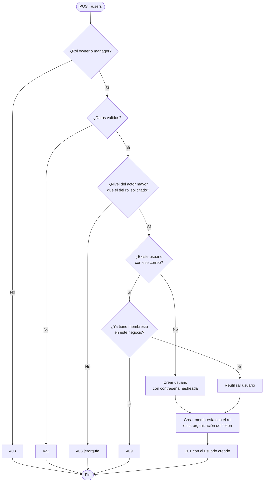

### Diagrama de flujo: desactivar un usuario

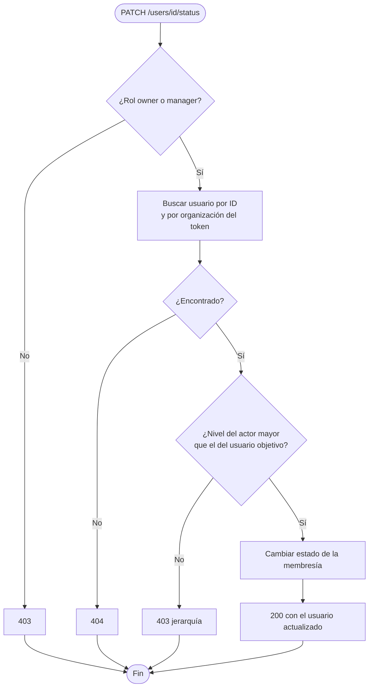

### Diagrama de flujo: qué puede gestionar cada rol

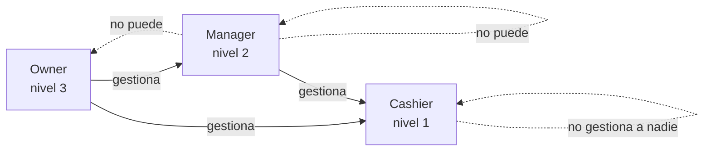

---

## Módulo 4: Productos (`products`)

### Casos de uso

| ID | Caso de uso | Actor | RF |
|---|---|---|---|
| CU-14 | Crear un producto | Owner, Manager | RF-06, RF-08 |
| CU-15 | Listar productos | Owner, Manager, Cashier | RF-06, RF-20 |
| CU-16 | Ver detalle de un producto | Owner, Manager, Cashier | RF-06 |
| CU-17 | Editar un producto o su precio | Owner, Manager | RF-06 |
| CU-18 | Desactivar o reactivar un producto | Owner, Manager | RF-06 |
| CU-19 | Gestionar categorías | Owner, Manager | RF-07 |

**CU-14 · Crear un producto**
- Precondición: sesión como owner o manager.
- Flujo principal: envía SKU, nombre, precio, stock inicial, stock mínimo y categoría opcional → el sistema valida → comprueba que el SKU no exista en el negocio → crea el producto → si hay stock inicial, registra un movimiento `entry`.
- Alternos: SKU repetido en el negocio (409); precio negativo (422); categoría de otro negocio (404); rol cashier (403).

**CU-18 · Desactivar un producto**
- Flujo principal: owner o manager desactiva un producto → ya no aparece para vender → las ventas históricas lo siguen mostrando.

### Historias de usuario

**HU-13** Como owner o manager, quiero registrar productos con precio y SKU, para tener el catálogo del negocio digital.
- El SKU es único dentro de mi negocio, pero otro negocio puede usar el mismo.
- El precio no puede ser negativo.

**HU-14** Como cashier, quiero ver la lista de productos con su precio y stock, para saber qué puedo vender.
- Solo veo productos activos de mi negocio.
- La lista está paginada.
- No puedo crear ni editar productos (403).

**HU-15** Como owner o manager, quiero desactivar un producto que ya no vendemos, para no perder su historial de ventas.
- Un producto nunca se borra.

**HU-16** Como owner o manager, quiero agrupar productos en categorías, para encontrarlos más rápido.

**HU-17** Como manager, quiero poder actualizar precios, para reaccionar a cambios de proveedores sin esperar al owner.

### Diagrama de flujo

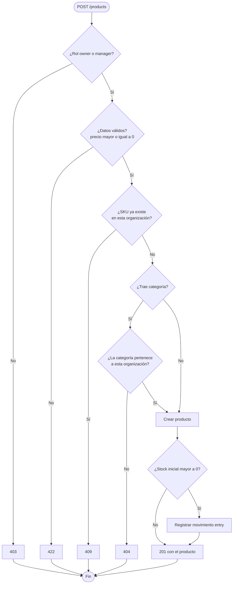

---

## Módulo 5: Inventario (`inventory`)

### Casos de uso

| ID | Caso de uso | Actor | RF |
|---|---|---|---|
| CU-20 | Registrar una entrada de stock | Owner, Manager | RF-09 |
| CU-21 | Registrar un ajuste de stock | Owner, Manager | RF-09 |
| CU-22 | Consultar historial de movimientos | Owner, Manager | RF-10 |
| CU-23 | Consultar productos con stock bajo | Owner, Manager, Cashier | RF-11 |

**CU-20 · Registrar una entrada**
- Precondición: el producto existe en el negocio y está activo.
- Flujo principal: indica producto y cantidad mayor a cero → el sistema suma al stock → crea un movimiento `entry` con el usuario y la fecha.
- Alternos: cantidad menor o igual a cero (422); producto de otro negocio (404); rol cashier (403).

**CU-21 · Registrar un ajuste**
- Flujo principal: indica producto, nueva cantidad o diferencia, y **motivo obligatorio** → el sistema aplica el ajuste → crea un movimiento `adjustment`.
- Alternos: el ajuste dejaría el stock negativo (409); sin motivo (422).

### Historias de usuario

**HU-18** Como owner o manager, quiero registrar la mercancía que llega, para que el stock refleje la realidad.
- El stock sube en la cantidad indicada.
- Queda un movimiento con quién lo hizo y cuándo.

**HU-19** Como owner o manager, quiero corregir el stock cuando hay pérdidas o errores, indicando el motivo, para tener trazabilidad.
- No se permite dejar el stock en negativo.
- El motivo es obligatorio.

**HU-20** Como cashier, manager u owner, quiero ver qué productos están por debajo del stock mínimo, para avisar o reponer.

**HU-21** Como owner o manager, quiero ver el historial de movimientos de un producto, para entender por qué cambió su stock.
- El historial no se puede editar ni borrar.
- Un cashier no puede verlo (403).

### Diagrama de flujo

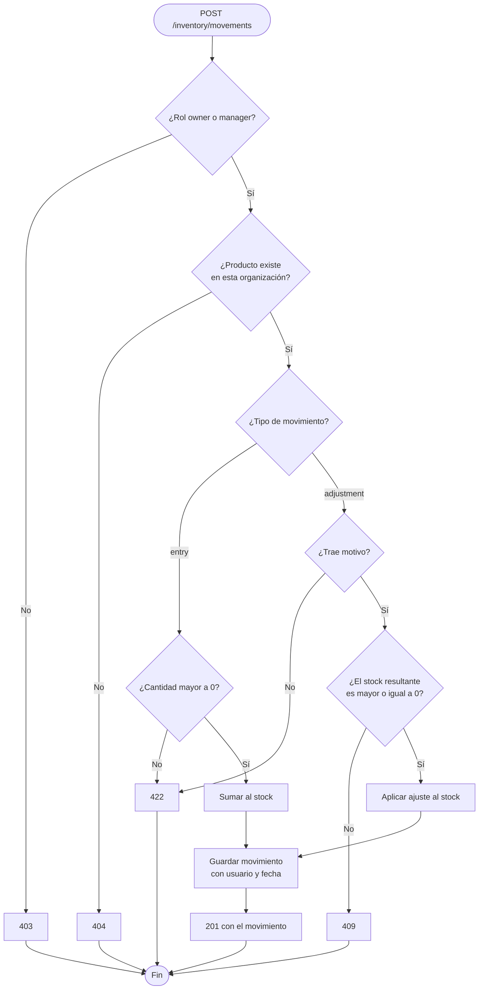

---

## Módulo 6: Ventas (`sales`)

### Casos de uso

| ID | Caso de uso | Actor | RF |
|---|---|---|---|
| CU-24 | Registrar una venta | Owner, Manager, Cashier | RF-12 a RF-15 |
| CU-25 | Listar ventas | Owner, Manager, Cashier | RF-17, RF-20 |
| CU-26 | Ver detalle de una venta | Owner, Manager, Cashier | RF-17 |
| CU-27 | Anular una venta | Owner, Manager | RF-16 |

**CU-24 · Registrar una venta**
- Precondición: sesión iniciada; los productos existen, están activos y pertenecen al negocio.
- Flujo principal: envía una lista de líneas (producto y cantidad) → el sistema valida cada línea → verifica stock de **todas** → copia el precio vigente a cada línea → calcula el total → descuenta el stock → crea movimientos `sale` → guarda la venta → responde con el detalle.
- Alternos: lista vacía (422); cantidad menor o igual a cero (422); producto inexistente o desactivado (404 o 409); stock insuficiente en alguna línea (409, y **no se guarda nada**).
- Postcondición: venta `completed`, stock descontado y movimientos creados, todo en una transacción.

**CU-25 · Listar ventas**
- Owner y manager ven todas las ventas del negocio; el cashier solo las que registró él.

**CU-27 · Anular una venta**
- Precondición: la venta pertenece al negocio y está `completed`.
- Flujo principal: owner o manager solicita la anulación con un **motivo** → el sistema devuelve el stock de cada línea → crea movimientos `void` → marca la venta `voided` con fecha, usuario y motivo.
- Alternos: venta ya anulada (409); venta de otra organización (404); sin motivo (422); rol cashier (403).

### Historias de usuario

**HU-22** Como cashier, quiero registrar una venta con varios productos, para cobrar al cliente rápidamente.
- El total lo calcula el servidor; no se acepta un total enviado por el cliente.
- Si algún producto no tiene stock suficiente, la venta no se guarda.

**HU-23** Como owner o manager, quiero que el stock baje automáticamente con cada venta, para no contarlo a mano.
- El descuento y la venta ocurren en la misma transacción.

**HU-24** Como cashier, quiero ver solo mis ventas, para revisar lo que he registrado.

**HU-25** Como owner o manager, quiero ver todas las ventas de mi negocio, para supervisar la operación.

**HU-26** Como owner o manager, quiero anular una venta hecha por error indicando el motivo, para que el stock y los reportes queden correctos.
- Al anular, el stock regresa.
- Una venta anulada no se puede anular otra vez.
- La venta anulada sigue visible en el historial, con quién la anuló y por qué.
- Un cashier no puede anular (403).

**HU-27** Como owner, quiero que el precio de una venta pasada no cambie si luego se sube el precio del producto, para que el historial sea fiel.

### Diagrama de flujo: registrar una venta

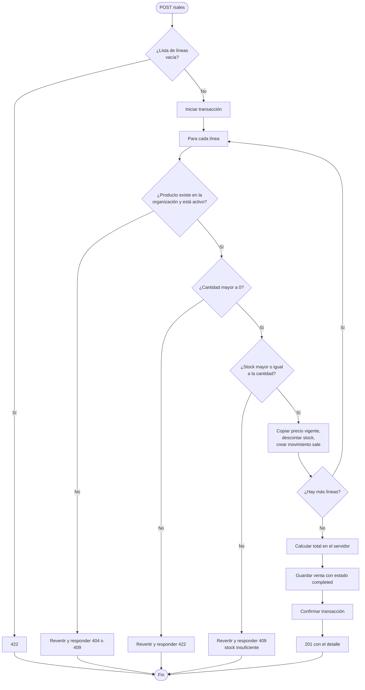

### Diagrama de flujo: anular una venta

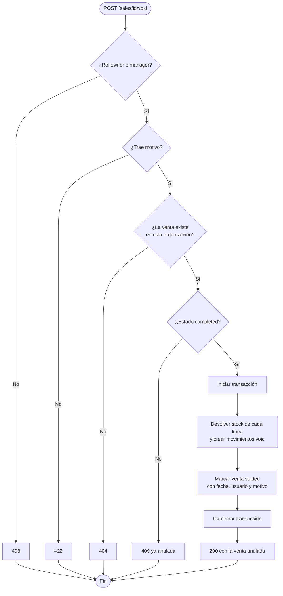

---

## Módulo 7: Reportes (`reports`)

### Casos de uso

| ID | Caso de uso | Actor | RF |
|---|---|---|---|
| CU-28 | Ver resumen de ventas por rango de fechas | Owner, Manager | RF-18 |
| CU-29 | Ver productos más vendidos | Owner, Manager | RF-19 |

**CU-28 · Resumen de ventas**
- Flujo principal: indica fecha inicial y final → el sistema suma las ventas `completed` del negocio en ese rango → devuelve cantidad de ventas, total vendido y promedio.
- Alternos: fecha final anterior a la inicial (422); sin ventas (se devuelven ceros); rol cashier (403).
- Las ventas anuladas no cuentan.

**CU-29 · Productos más vendidos**
- Flujo principal: indica el periodo y cuántos productos quiere ver → el sistema agrupa líneas por producto y ordena por cantidad vendida.

### Historias de usuario

**HU-28** Como owner o manager, quiero saber cuánto se vendió en un periodo, para conocer cómo va el negocio.
- No incluye ventas anuladas.
- Solo cuenta ventas de mi negocio.

**HU-29** Como owner o manager, quiero ver cuáles son los productos más vendidos, para decidir qué reponer.

### Diagrama de flujo

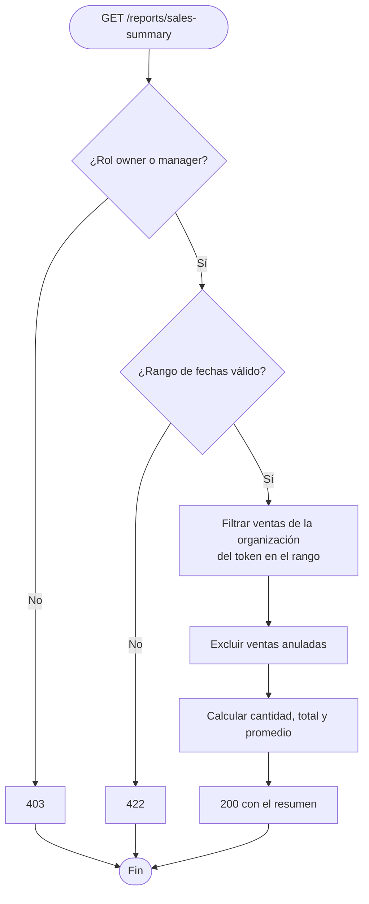

---

## Casos transversales

### Aislamiento entre organizaciones y permisos

| ID | Caso | Resultado esperado |
|---|---|---|
| CU-30 | Un usuario de la organización A pide un recurso de la B por ID | 404 (nunca 403, para no revelar que existe) |
| CU-31 | Un usuario intenta enviar un `organization_id` en el cuerpo | Se ignora; manda el del token |
| CU-32 | Dos organizaciones usan el mismo SKU | Ambas pueden |
| CU-33 | Un cashier intenta una acción de manager u owner | 403 |
| CU-34 | Un manager intenta una acción exclusiva del owner (editar el negocio, cambiar roles, crear managers) | 403 |
| CU-35 | Un manager intenta desactivar o editar a otro manager o al owner | 403 |

**HU-30** Como owner, quiero la certeza de que ningún otro negocio puede ver mis datos, para confiar mi información al sistema.
- Existen pruebas automáticas que lo comprueban para cada módulo.

**HU-31** Como owner, quiero que ningún manager ni cashier pueda saltarse sus permisos llamando directamente a la API, para que la seguridad no dependa de la interfaz.
- Existen pruebas que llaman a cada ruta restringida con cada rol y comprueban el código de respuesta.

### Diagrama de flujo: acceso a un recurso por ID

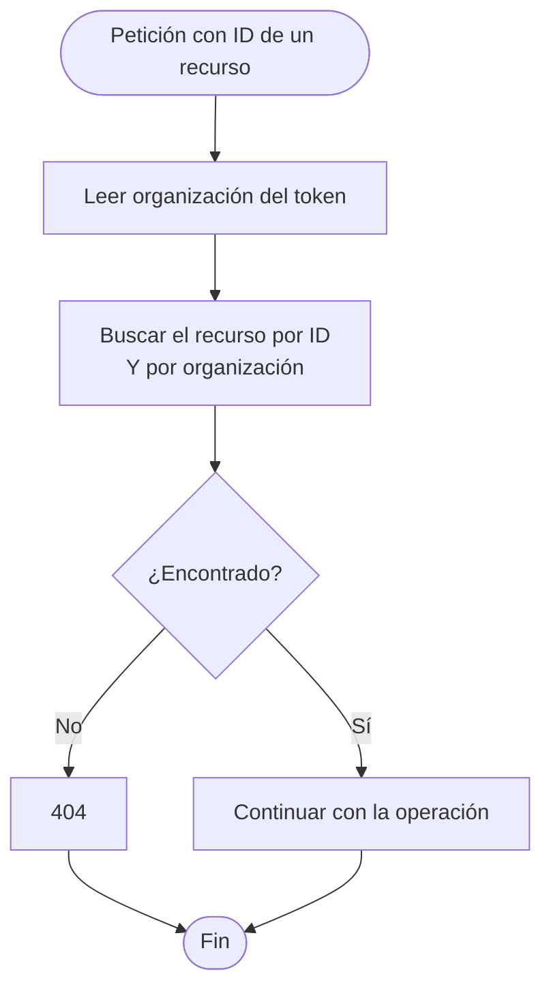

---

## Matriz de pruebas de roles (referencia para `test_hierarchy.py`)

Cada fila es una prueba. Se llama a la ruta con el rol indicado y se comprueba el código.

| Ruta | Owner | Manager | Cashier |
|---|---|---|---|
| `PUT /organization` | 200 | 403 | 403 |
| `POST /users` (rol `manager`) | 201 | 403 | 403 |
| `POST /users` (rol `cashier`) | 201 | 201 | 403 |
| `PATCH /users/{id}/status` (objetivo manager) | 200 | 403 | 403 |
| `PATCH /users/{id}/status` (objetivo cashier) | 200 | 200 | 403 |
| `PATCH /users/{id}/role` | 200 | 403 | 403 |
| `POST /products` | 201 | 201 | 403 |
| `POST /inventory/movements` | 201 | 201 | 403 |
| `POST /sales` | 201 | 201 | 201 |
| `POST /sales/{id}/void` | 200 | 200 | 403 |
| `GET /reports/sales-summary` | 200 | 200 | 403 |

---

## Trazabilidad: historias → requerimientos

| Historia | Requerimientos | Módulo |
|---|---|---|
| HU-01 | RF-01 | auth |
| HU-02 | RF-02 | auth |
| HU-03 | RF-03 | auth |
| HU-04, HU-05, HU-06 | RF-03, RF-23 | organizations |
| HU-07, HU-08, HU-09, HU-10, HU-11, HU-12 | RF-04, RF-05, RF-21, RF-22, RF-23 | users |
| HU-13 a HU-17 | RF-06, RF-07, RF-08, RF-20 | products |
| HU-18 a HU-21 | RF-09, RF-10, RF-11 | inventory |
| HU-22 a HU-27 | RF-12 a RF-17 | sales |
| HU-28, HU-29 | RF-18, RF-19 | reports |
| HU-30, HU-31 | RNF-01, RNF-11 | transversal |

## Orden sugerido de desarrollo

1. Módulos 1 y 3 (auth y users): sin identidad ni jerarquía no hay organización.
2. Módulo 2 (organizations).
3. Módulo 4 (products) y su prueba de aislamiento.
4. Módulo 5 (inventory).
5. Módulo 6 (sales): es el más complejo, por la transacción.
6. Módulo 7 (reports).
